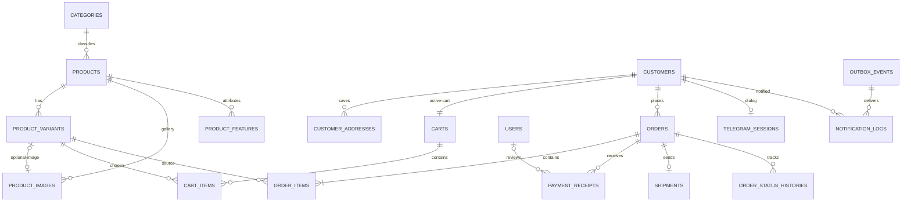

# Denapax — Database ERD & Data Dictionary v1.0

**Status:** Technical baseline for migration design; no migrations have been run yet.  
**Database:** MySQL 8+ (actual supported version verified at scaffold).  
**Conventions:** primary keys `BIGINT UNSIGNED` unless stated, foreign keys indexed, `created_at`/`updated_at` on mutable tables. Money is **integer IRR**; weights are **integer grams**. All examples are illustrative.

## ERD (MVP)


Notes: `telegram_updates`, singleton settings and the general admin audit log are infrastructure tables not shown to keep the ERD readable. A customer's active cart is one persistent row, and its items are cleared after successful checkout. `shipment` is optional until dispatch.

## Catalog

### `categories`
| Column | Type | Rules |
|---|---|---|
| id | bigint unsigned | PK |
| name | varchar(160) | required |
| slug | varchar(180) | unique |
| is_active | boolean | default true |
| sort_order | unsigned int | default 0 |
| created_at / updated_at | timestamp | standard |

### `products`
| Column | Type | Rules |
|---|---|---|
| id | bigint unsigned | PK |
| category_id | bigint unsigned | FK categories.id, required |
| title | varchar(220) | required |
| slug | varchar(240) | unique |
| summary | varchar(600) | required for bot summary |
| description | text | nullable |
| is_active | boolean | default false until published |
| created_at / updated_at | timestamp | standard |
| deleted_at | timestamp | nullable; archive rather than hard-delete sold products |

Indexes: `(category_id, is_active)`, optional targeted text search index after benchmarking. Product belongs to **one** category.

### `product_features`
`id` (PK), `product_id` (FK), `name varchar(100)`, `value varchar(500)`, `sort_order unsigned int`. Values apply to the **whole product**; no variant options table.

### `product_variants`
| Column | Type | Rules |
|---|---|---|
| id | bigint unsigned | PK |
| product_id | bigint unsigned | FK products.id |
| sku | varchar(100) | unique |
| title | varchar(180) | e.g., 500g package |
| sale_quantity | decimal(12,3) | positive |
| sale_unit | varchar(16) | one of `g`, `kg`, `l`, `piece` |
| price_irr | bigint unsigned | >= 0; price in rial |
| shipping_weight_grams | unsigned int | **strictly positive** |
| is_available | boolean | default false |
| sort_order | unsigned int | default 0 |
| created_at / updated_at | timestamp | standard |

Indexes: `(product_id, is_available, sort_order)`. No numeric stock. Cart item quantity is number of units of this variant (positive integer), not arbitrary grams.

### `product_images`
`id` (PK), `product_id` (FK), `product_variant_id` (FK nullable), `storage_path varchar(500)`, `alt_text varchar(250) nullable`, `sort_order unsigned int`, `created_at`, `updated_at`.

Rules:
- `product_variant_id IS NULL` => product gallery image; sort_order determines gallery order/cover.
- Non-null => optional dedicated image for that variant, unique `product_variant_id` (max one per variant in MVP).
- Assert `product_images.product_id = product_variants.product_id` when variant is assigned (application validation; can be strengthened with composite FK).
- Photos live in image storage, **not** MySQL BLOBs.

## Customer & cart

### `customers`
`id` (PK), `telegram_user_id bigint unsigned UNIQUE`, `telegram_chat_id bigint nullable`, `display_name varchar(220) nullable`, `full_name varchar(220) nullable`, `mobile varchar(24) nullable`, `created_at`, `updated_at`.

Telegram ID is the trusted customer key. A customer must have started the bot to receive transactional messages.

### `customer_addresses`
`id` (PK), `customer_id` (FK), `label varchar(80) nullable`, `recipient_name varchar(220)`, `recipient_mobile varchar(24)`, `province varchar(100)`, `city varchar(100)`, `address_line text`, `postal_code varchar(16)`, `is_default boolean`, timestamps.

Indexes: `(customer_id, is_default)`. Ensure at most one default per customer in application transaction. Addresses may be edited or deleted, but existing order snapshots remain unchanged.

### `carts`
`id` (PK), `customer_id` (FK UNIQUE), timestamps. Exactly one active cart per customer; no history is needed because an order is the historical record.

### `cart_items`
`id` (PK), `cart_id` (FK), `product_variant_id` (FK), `quantity unsigned int` (>0), timestamps. Unique `(cart_id, product_variant_id)`. No authoritative price on cart items: reprice on checkout.

## Orders and financial snapshots

### `orders`
| Column | Type | Rules |
|---|---|---|
| id | bigint unsigned | PK |
| order_number | varchar(32) | unique, user-facing |
| checkout_key | char(36) | unique UUID for idempotent final checkout |
| customer_id | bigint unsigned | FK customers.id |
| order_status | varchar(32) | state machine below |
| payment_status | varchar(32) | separate payment state |
| recipient_name | varchar(220) | snapshot |
| recipient_mobile | varchar(24) | snapshot |
| province | varchar(100) | snapshot |
| city | varchar(100) | snapshot |
| address_line | text | snapshot |
| postal_code | varchar(16) | snapshot |
| goods_subtotal_irr | bigint unsigned | snapshot |
| shipping_fee_irr | bigint unsigned | snapshot |
| total_irr | bigint unsigned | subtotal + shipping |
| shipping_weight_grams | unsigned bigint | computed shipment weight, snapshot |
| shipping_rule_snapshot | json | base/step prices, grams, packaging settings |
| payment_instructions_snapshot | json | card number + holder display details |
| created_at / updated_at | timestamp | timestamps |

Indexes: `(customer_id, created_at)`, `(order_status, created_at)`, `(payment_status, created_at)`. Never derive historical totals by joining today's catalog prices. Order must have >=1 item.

### `order_items`
| Column | Type | Rules |
|---|---|---|
| id | bigint unsigned | PK |
| order_id | bigint unsigned | FK orders.id |
| product_id | bigint unsigned | FK products.id |
| product_variant_id | bigint unsigned | FK product_variants.id |
| sku_snapshot | varchar(100) | immutable |
| product_title_snapshot | varchar(220) | immutable |
| variant_title_snapshot | varchar(180) | immutable |
| sale_quantity_snapshot | decimal(12,3) | immutable |
| sale_unit_snapshot | varchar(16) | immutable |
| unit_weight_grams_snapshot | unsigned int | immutable |
| unit_price_irr | bigint unsigned | immutable |
| quantity | unsigned int | >0 |
| line_total_irr | bigint unsigned | `unit_price_irr × quantity` |
| created_at / updated_at | timestamp | standard |

Keep referenced products/variants archived, not hard deleted. Snapshot fields alone must be sufficient to render old orders.

## Manual payments

### `payment_receipts`
| Column | Type | Rules |
|---|---|---|
| id | bigint unsigned | PK |
| order_id | bigint unsigned | FK orders.id |
| attempt_number | unsigned int | unique with order_id, starts at 1 |
| telegram_file_id | varchar(512) | received file handle, optional backup reference |
| storage_path | varchar(500) | PRIVATE storage |
| status | varchar(20) | `pending`, `approved`, `rejected` |
| rejection_reason | text | only when rejected |
| reviewed_by | bigint unsigned | nullable FK users.id |
| submitted_at | timestamp | required |
| reviewed_at | timestamp | nullable |
| created_at / updated_at | timestamp | standard |

Indexes: `(order_id, attempt_number)` UNIQUE, `(status, submitted_at)`. One pending attempt per order at a time enforced using transaction + lock (not via a non-existent MySQL partial unique index). Receipt must not be approved more than once.

### `users`
Laravel-authenticated admin users: `id`, `name`, `email UNIQUE`, `password_hash` (Laravel convention `password`), `is_active`, remember/session fields, timestamps. MVP has one admin role/capability tier (no complex RBAC).

## Shipping and settings

### `shipments`
`id` (PK), `order_id` (FK UNIQUE), `carrier varchar(80)` (e.g., Iran Post), `tracking_code varchar(120) nullable`, `shipped_at timestamp nullable`, `delivered_at timestamp nullable`, `recorded_by bigint unsigned nullable` (FK users.id), timestamps.

One order corresponds to one parcel. Tracking is entered manually.

### `shipping_settings` (singleton row, id=1)
`id`, `base_weight_grams unsigned int` (>0), `base_price_irr bigint unsigned`, `extra_step_grams unsigned int` (>0), `extra_step_price_irr bigint unsigned`, `packaging_weight_grams unsigned int` (>=0), `updated_by bigint unsigned nullable`, timestamps.

Formula:
```text
W = sum(order_item.unit_weight_grams_snapshot * quantity) + packaging_weight_grams
tiers = ceil(max(0, W - base_weight_grams) / extra_step_grams)
shipping_fee_irr = base_price_irr + tiers * extra_step_price_irr
```
Read current configuration only at checkout, snapshot into `orders`, and never retroactively change paid/unpaid order fees.

### `store_settings` (singleton row, id=1)
`id`, `store_name varchar(160)`, `support_contact varchar(160) nullable`, `card_number varchar(32)`, `card_holder_name varchar(200)`, `updated_by bigint unsigned nullable`, timestamps. A past order includes the payment instructions presented at creation.

## Operations, bot and audit

### `order_status_histories`
`id` (PK), `order_id` (FK), `from_status varchar(32) nullable`, `to_status varchar(32)`, `actor_type varchar(16)` (`admin`/`system`), `admin_user_id bigint unsigned nullable`, `note text nullable`, `created_at`. Index `(order_id, created_at)`.

### `telegram_updates`
`update_id bigint` (PK, Telegram assigned), `status varchar(16)` (`processing`, `done`, `failed`), `received_at timestamp`, `processed_at timestamp nullable`, `error_summary text nullable`. Durable deduplication must not incorrectly swallow interrupted/failed work.

### `telegram_sessions`
`customer_id bigint unsigned` (PK/FK), `state varchar(100)`, `context json nullable`, `expires_at timestamp nullable`, `updated_at timestamp`. Used for stepwise bot flow (address entry, receipt wait, etc.), resumable and safely resettable.

### `outbox_events`
`id char(36)` (UUID PK), `aggregate_type varchar(80)`, `aggregate_id bigint unsigned`, `event_type varchar(120)`, `payload json`, `occurred_at timestamp`, `processed_at timestamp nullable`. Created in the same transaction as the business change.

### `notification_logs`
`id` (PK), `outbox_event_id char(36)` (FK), `customer_id` (FK), `channel varchar(20)` (=telegram), `status varchar(20)` (`queued`, `sent`, `failed`), `attempts unsigned int`, `telegram_message_id bigint nullable`, `last_error text nullable`, `sent_at timestamp nullable`, timestamps.

Unique `(outbox_event_id, customer_id, channel)`. Network-timeout edge cases mean true exactly-once message delivery cannot be guaranteed by Telegram; prevent duplicate business events and perform bounded retries.

### `admin_audit_logs`
`id` (PK), `admin_user_id` (FK), `action varchar(120)`, `entity_type varchar(100)`, `entity_id bigint unsigned`, `metadata json nullable`, `created_at`. Store changes to receipt decisions and order/shipping status.

## Enumerations and integrity rules
- Order: `awaiting_payment` → `confirmed` → `preparing` → `shipped` → `delivered`; `awaiting_payment` → `canceled` by admin.
- Payment: `awaiting_receipt` → `under_review` → `approved` OR `rejected` → `under_review` on new receipt.
- `approved` must be terminal for MVP. Keep payment and order statuses synchronized inside transactions.
- Product must be active, category active, and variant available before checkout.
- Product image linked to variant must reference **the same product**.
- Store snapshots immutably even if customer changes addresses, product prices, sale units or shipping settings.
- Create order and clearing cart must be one transaction; use checkout key to avoid duplicates from repeat callbacks.
- Validate positive gram weights and quantities, proper national phone/postal-code formats at application boundary; choose database CHECKs supported by deployed MySQL.

## Migration build order
1. users, categories, products, product_variants, product_images, product_features
2. customers, customer_addresses, carts, cart_items
3. shipping_settings, store_settings
4. orders, order_items, payment_receipts, shipments, order_status_histories
5. telegram_updates, telegram_sessions, outbox_events, notification_logs, admin_audit_logs

## Open implementation details (not MVP scope changes)
- Select numeric price column limits, string collations, maximum message/photo sizes and storage provider during migrations.
- Choose exact checkout key lifecycle and bot session expiration when implementing flows.
- Pin MySQL/Laravel minor versions at scaffold and preserve tests and migration compatibility.
