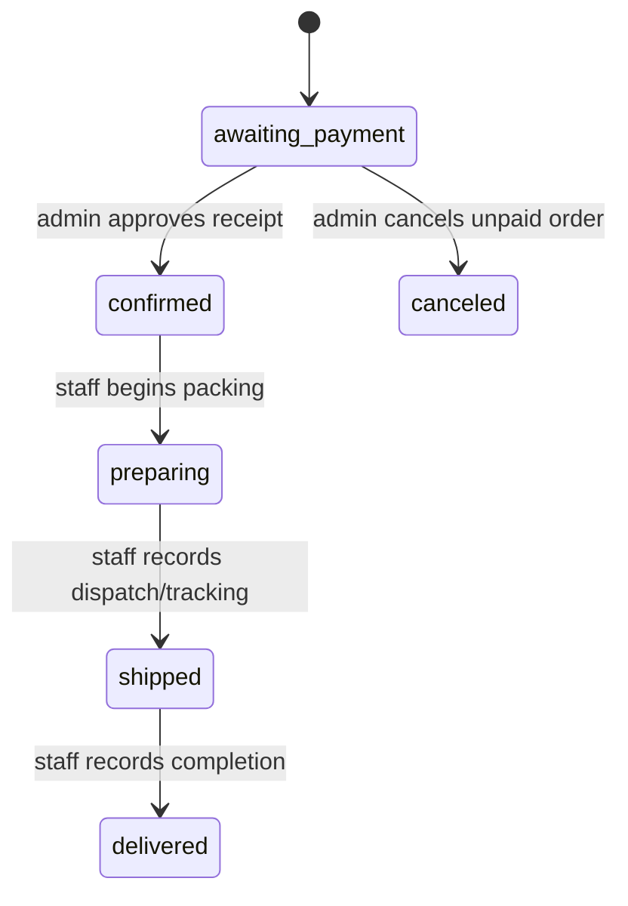
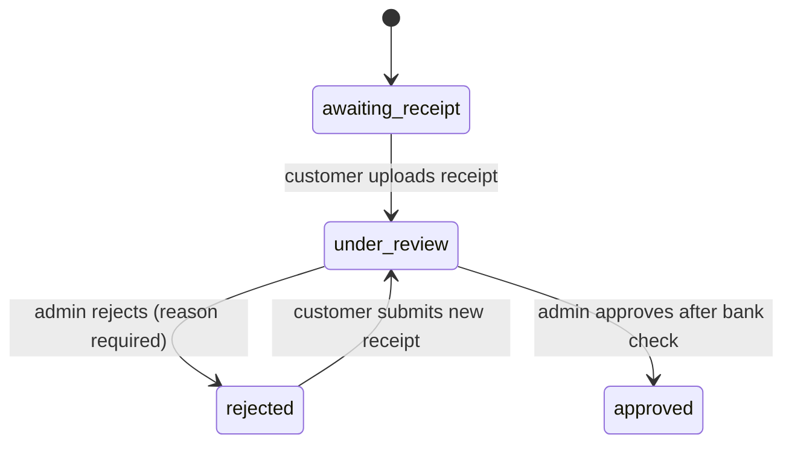

# Denapax — Order, Payment & Notification Workflows v1.0

**Scope reference:** [MVP v1.1](01-mvp-scope.md)  
**Data model:** [ERD & Dictionary](03-database-design.md)

## Telegram customer journey
1. `/start` creates/updates Telegram customer identity and shows main menu: browse, search, cart, my orders, support.
2. Browse category/paginated list or search product title/description; product detail displays gallery/main image, summary, features, and available variants with prices and sale units.
3. Select variant, then integer item quantity; add to cart. Customer can edit/remove items and resume.
4. Checkout first validates variants are active and reprices from authoritative database records.
5. Customer selects a saved address or enters recipient name, mobile, province, city, address line and postal code; optionally save as address.
6. Show final goods subtotal, shipping weight in grams, national weight-based fee and order total. Show a final **confirm order** button.
7. On confirmation, `CreateOrder` with a unique checkout key writes the order, items, snapshots and history atomically; clears cart.
8. Bot shows order number, final amount and card-to-card instructions. Customer sends receipt photo/document.
9. Receipt submission creates pending receipt and payment-under-review status. Bot acknowledges receipt but does **not** claim payment is confirmed.
10. Admin reviews actual bank deposit externally and accepts or rejects. Customer receives appropriate notification. Rejected receipt allows a new attempt.
11. Admin prepares and dispatches after approval; adds postal tracking. Customer can browse own orders and see status and tracking.

## State transitions

Only `under_review` receipt can be approved/rejected; only latest currently pending receipt is actionable. Approval moves order from `awaiting_payment` to `confirmed` within same transaction. Order cannot advance to packing or shipping otherwise. Cancellation in MVP is for unpaid orders only.

## Receipt review — invariants
- Verify current user is admin; present private receipt media through authenticated access only.
- New upload validates ownership, order payment eligibility, MIME, file size and prevents simultaneous pending attempts.
- Store the receipt in private storage (Telegram file reference can also be saved). Do not expose storage paths publicly.
- On rejection, require nonempty reason; set receipt to rejected, order payment status to rejected and notify user with resubmit action.
- On approval, store reviewer, review time, receipt status and payment approval; insert audit/history and outbox event atomically.
- Repeated admin action must fail safely with an already-reviewed response, not create a second confirmation.

## Notification event table
| Event | Recipient message | De-duplication |
|---|---|---|
| order.created | order number, subtotal/shipping/total, card info | one per order creation |
| payment.receipt_submitted | receipt received, awaiting review | one per receipt ID |
| payment.receipt_rejected | reason + resubmit action | one per receipt decision |
| payment.approved | payment accepted | one per approval |
| order.preparing | preparing status | one per transition |
| order.shipped | tracking code & sent status | one per transition |
| order.delivered | delivery recorded | one per transition |
| order.canceled | order canceled | one per transition |

Events are persisted transactionally to `outbox_events`. A queue worker creates/updates `notification_logs` and sends via Telegram Bot API with retries/backoff. Telegram may be unavailable or the user may block the bot; failures are visible to admin logs and must not roll back the business operation.

## Shipping calculation examples
Assume `base_weight_grams=1000`, `base_price_irr=1,000,000` (100,000 toman), `extra_step_grams=1000`, `extra_step_price_irr=500,000` (50,000 toman), packaging weight already included below.

| Weight | Extra tiers | Fee (toman) |
| ---: | ---: | ---: |
| 250 g | 0 | 100,000 |
| 1000 g | 0 | 100,000 |
| 1001 g | 1 | 150,000 |
| 2000 g | 1 | 150,000 |
| 2001 g | 2 | 200,000 |

Tests must also verify total product weight + packaging: 900g goods + 150g packaging → 1050g and first extra tier. Example rates are store configuration, **not an official Post tariff guarantee**.

## Security and operational checks
- Only process Telegram webhook from verified source/secret header; store update IDs uniquely and recover safely from failed processing.
- Per-user order lookup by authenticated Telegram identity; never authorize solely by guessed order number.
- Validate Telegram callback context against customer and current state; checkout key prevents repeat orders.
- Rate-limit search and risky actions to avoid spam and abuse.
- Log relevant status changes and receipt decisions, without leaking personal details or bot token.
- Store a backup of private receipt media and database; define retention and legal/privacy policies before launch.

## Acceptance scenarios
- Search → variant → multi-item cart → checkout with shipping snapshot → receipt upload → approval → preparation → dispatch with tracking.
- Receipt rejection with reason → resubmission → acceptance, no loss of history.
- Duplicate Telegram callback, repeated receipt photo update, double-click admin approval: no duplicate logical state transition.
- Boundary weights 0.25kg, 1kg, 1.001kg, 2kg, 2.001kg; packaging included.
- Changes to price, card number, address or shipping configuration after checkout do not alter historic order.
- Another Telegram user cannot read someone else's order, receipt or address.
